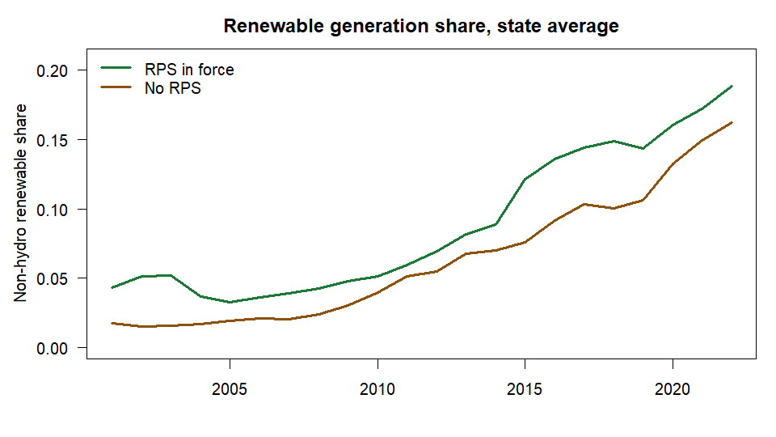
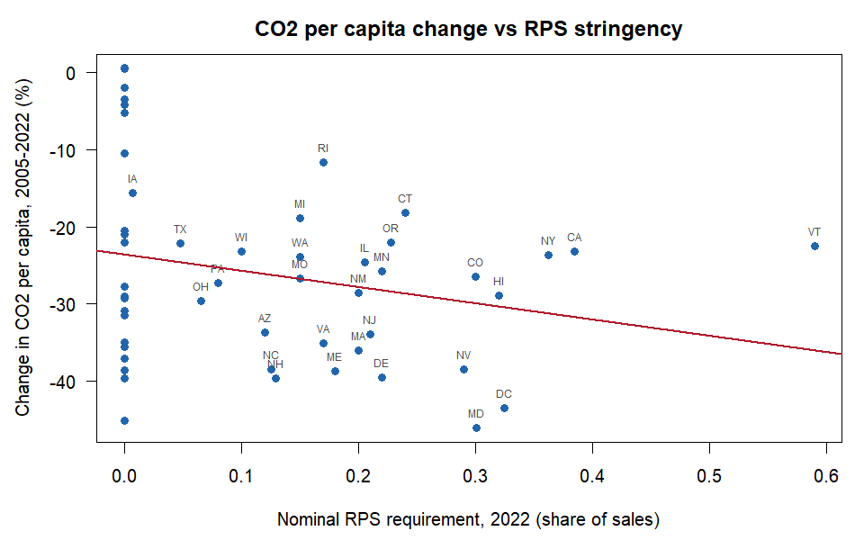
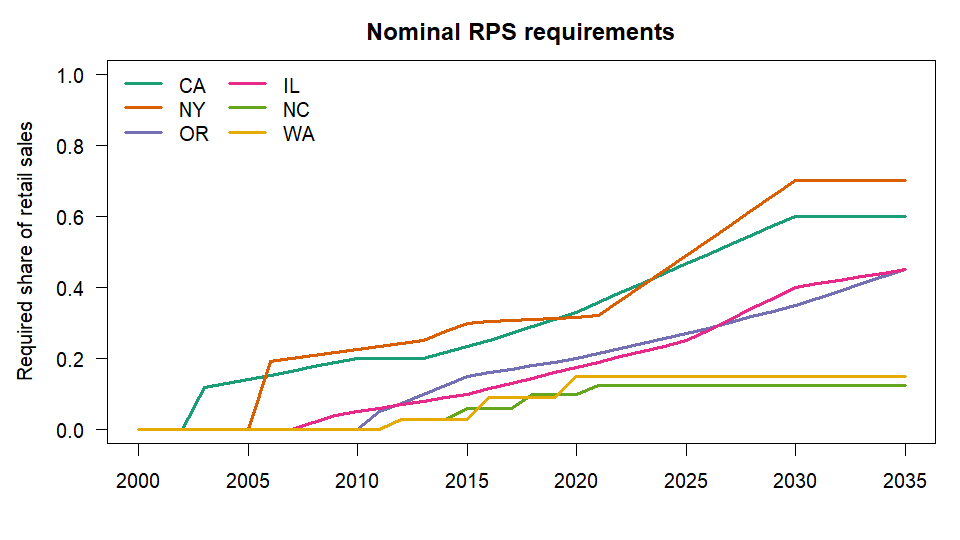

<!-- README.md is generated from README.Rmd. Please edit that file -->

# rpspanel

<!-- badges: start -->

[](https://github.com/adebayomoses/rpspanel/actions/workflows/R-CMD-check.yaml)
<!-- badges: end -->

**rpspanel** gives researchers a documented, reproducible US
state-by-year energy-economy panel (50 states + DC), with Renewable
Portfolio Standard (RPS) stringency measures, in a few lines of R.

- **One call, one panel.** `build_panel()` merges EIA energy use, prices
  and production (SEDS), electricity generation and retail sales, state
  CO2 emissions, and BEA GDP, income and population.
- **Reproducible.** Every variable’s source, vintage and transformation
  is recorded; `codebook()` and `cite_sources()` document the panel.
  Downloads are cached so vintages stay pinned.
- **Better policy measures.** `rps_stringency()` returns adoption,
  nominal, coverage-adjusted and incremental (Yin and Powers 2010)
  requirements, plus design-flexibility indicators.
- **Fits existing tools.** `as_pdata()` hands the panel to `plm`,
  `fixest` or `csdm`; `export_panel()` writes CSV, Stata or Parquet.

## Installation

``` r
# install.packages("remotes")
remotes::install_github("adebayomoses/rpspanel")
```

## API keys

Register for free keys at <https://www.eia.gov/opendata/register.php>
and <https://apps.bea.gov/API/signup/>, then add them to `.Renviron`:

    EIA_API_KEY=your-eia-key
    BEA_API_KEY=your-bea-key

## Live example

Everything below is real output, produced by knitting this README
against the live EIA and BEA APIs (15 October 2026).

### One call builds the whole panel

``` r
library(rpspanel)

t0 <- Sys.time()
panel <- build_panel(years = 2001:2022)
#> Fetching eia_seds (9 series)
#> Fetching eia_generation (10 series)
#> Fetching eia_retail_sales (2 series)
#> Fetching eia_co2 (6 series)
#> Fetching bea_regional (6 series)
#> Fetching bea_nipa (1 series)
Sys.time() - t0
#> Time difference of 1.75906 mins

dim(panel)
#> [1] 1122   56
names(panel)
#>  [1] "state"               "state_name"          "fips"               
#>  [4] "year"                "energy_cons_total"   "energy_cons_res"    
#>  [7] "energy_cons_com"     "energy_cons_ind"     "energy_cons_trans"  
#> [10] "energy_prod_total"   "renew_cons_total"    "energy_price_avg"   
#> [13] "energy_expend_total" "gen_total"           "gen_coal"           
#> [16] "gen_gas"             "gen_nuclear"         "gen_hydro"          
#> [19] "gen_wind"            "gen_solar"           "gen_geothermal"     
#> [22] "gen_wood"            "gen_biomass_other"   "elec_sales"         
#> [25] "elec_price"          "co2_total"           "co2_elec"           
#> [28] "co2_ind"             "co2_trans"           "co2_res"            
#> [31] "co2_com"             "gdp_real"            "gdp_real_manuf"     
#> [34] "gdp_nominal"         "personal_income"     "population"         
#> [37] "income_pc"           "gdp_deflator"        "gen_renew_nonhydro" 
#> [40] "re_share_nonhydro"   "re_share_total"      "elec_price_real"    
#> [43] "energy_price_real"   "energy_cons_pc"      "energy_intensity"   
#> [46] "co2_pc"              "co2_intensity"       "gdp_real_pc"        
#> [49] "rps_adoption"        "rps_nominal"         "rps_coverage_adj"   
#> [52] "rps_incremental"     "rps_baseline_share"  "rps_oos_rec"        
#> [55] "rps_carveout"        "rps_acp"

print(panel[panel$state == "CA" & panel$year >= 2018,
            c("state", "year", "energy_cons_total", "gen_total", "re_share_nonhydro",
              "co2_total", "gdp_real", "population", "rps_nominal")])
#> <rps_panel>: 1 state x 2018-2022 (5 rows), 7 variables
#>     state year energy_cons_total gen_total re_share_nonhydro co2_total gdp_real
#> 106    CA 2018           7294353  195465.6         0.2999626  356.6808  2850609
#> 107    CA 2019           7232052  201784.2         0.2920013  356.5132  2969066
#> 108    CA 2020           6433619  193083.5         0.3152571  301.9630  2933002
#> 109    CA 2021           6778817  197165.1         0.3377095  324.0795  3167936
#> 110    CA 2022           6857539  203383.9         0.3437623  326.2054  3161153
#>     population rps_nominal
#> 106   39535920      0.2900
#> 107   39547995      0.3100
#> 108   39527808      0.3300
#> 109   39152927      0.3575
#> 110   39125347      0.3850
```

The first build downloads every series from the seven sources. After
that the data come from the local cache, so the same vintage is used
every time until you pass `refresh = TRUE`.

### Where every number comes from

``` r
attr(panel, "sources")[c("source", "retrieved")]
#>             source           retrieved
#> 1         eia_seds 2026-10-15 13:36:55
#> 2   eia_generation 2026-10-15 13:37:23
#> 3 eia_retail_sales 2026-10-15 13:37:24
#> 4          eia_co2 2026-10-15 13:37:32
#> 5     bea_regional 2026-10-15 13:37:34
#> 6         bea_nipa 2026-10-15 13:37:40
#> 7      rps_bundled               0.1.0

head(codebook(panel), 8)
#>            variable  group                                          label
#> 1 energy_cons_total energy                       Total energy consumption
#> 2   energy_cons_res energy          Residential sector energy consumption
#> 3   energy_cons_com energy           Commercial sector energy consumption
#> 4   energy_cons_ind energy           Industrial sector energy consumption
#> 5 energy_cons_trans energy       Transportation sector energy consumption
#> 6 energy_prod_total energy                Total primary energy production
#> 7  renew_cons_total energy             Total renewable energy consumption
#> 8  energy_price_avg energy Average price of energy, all sectors (nominal)
#>                      unit   source series transformation
#> 1             billion Btu eia_seds  TETCB   As published
#> 2             billion Btu eia_seds  TERCB   As published
#> 3             billion Btu eia_seds  TECCB   As published
#> 4             billion Btu eia_seds  TEICB   As published
#> 5             billion Btu eia_seds  TEACB   As published
#> 6             billion Btu eia_seds  TEPRB   As published
#> 7             billion Btu eia_seds  RETCB   As published
#> 8 dollars per million Btu eia_seds  TETCD   As published
```

``` r
cite_sources(panel)
#> U.S. Energy Information Administration (2026). State Energy Data System (SEDS). https://www.eia.gov/state/seds/. Retrieved 2026-10-15 13:36:55 UTC.
#> 
#> U.S. Energy Information Administration (2026). Electric Power Operational Data (Forms EIA-923, EIA-906, EIA-920). https://www.eia.gov/electricity/data/state/. Retrieved 2026-10-15 13:37:23 UTC.
#> 
#> U.S. Energy Information Administration (2026). Electricity Retail Sales (Form EIA-861). https://www.eia.gov/electricity/data/state/. Retrieved 2026-10-15 13:37:24 UTC.
#> 
#> U.S. Energy Information Administration (2026). State Energy-Related Carbon Dioxide Emissions. https://www.eia.gov/environment/emissions/state/. Retrieved 2026-10-15 13:37:32 UTC.
#> 
#> U.S. Bureau of Economic Analysis (2026). Regional Economic Accounts (SAGDP, SAINC tables). https://apps.bea.gov/regional/. Retrieved 2026-10-15 13:37:34 UTC.
#> 
#> U.S. Bureau of Economic Analysis (2026). National Income and Product Accounts, Table 1.1.9. https://apps.bea.gov/iTable/?reqid=19. Retrieved 2026-10-15 13:37:40 UTC.
#> 
#> rpspanel authors (2026). rpspanel RPS rule coding (bundled). https://github.com/adebayomoses/rpspanel. Coding shipped with rpspanel 0.1.0.
#> 
#> Adebayo, M. (2026). rpspanel: US state energy-economy panels with renewable portfolio standards. R package version 0.1.0.
```

### A first look at the data

``` r
snap <- as.data.frame(panel)
snap <- snap[snap$year == 2022 & snap$state %in% c("CA", "TX", "NY", "IA", "WY", "VT"),
             c("state", "co2_pc", "re_share_nonhydro", "gdp_real_pc",
               "elec_price_real", "rps_nominal")]
print(snap, digits = 3, row.names = FALSE)
#>  state co2_pc re_share_nonhydro gdp_real_pc elec_price_real rps_nominal
#>     CA   8.34            0.3438       80796           18.92      0.3850
#>     IA  22.33            0.6353       63181            8.11      0.0065
#>     NY   8.42            0.0658       89492           15.53      0.3622
#>     TX  22.01            0.2639       66566            8.61      0.0472
#>     VT   8.50            0.4733       54895           14.40      0.5900
#>     WY  96.58            0.2150       64183            6.98      0.0000
```

National totals match the published figures (2020: about 4,570 million
tonnes of energy-related CO2, 4,010 TWh of net generation, 331.6 million
people):

``` r
y20 <- panel[panel$year == 2020, ]
c(co2_mt = sum(y20$co2_total), generation_twh = sum(y20$gen_total) / 1000,
  population_m = sum(y20$population) / 1e6, real_gdp_tn = sum(y20$gdp_real) / 1e6)
#>         co2_mt generation_twh   population_m    real_gdp_tn 
#>      4571.9727      4009.7668       331.5781        20.1624
```

``` r
d <- as.data.frame(panel)
d$group <- ifelse(d$rps_adoption %in% 1, "RPS in force", "No RPS")
avg <- aggregate(re_share_nonhydro ~ year + group, data = d, FUN = mean)

par(mar = c(4, 4.5, 2.5, 1), las = 1)
plot(NA, xlim = range(avg$year), ylim = c(0, max(avg$re_share_nonhydro) * 1.1),
     xlab = "", ylab = "Non-hydro renewable share", main = "Renewable generation share, state average")
cols <- c("RPS in force" = "#1b7837", "No RPS" = "#8c510a")
for (g in names(cols)) {
  s <- avg[avg$group == g, ]
  lines(s$year, s$re_share_nonhydro, col = cols[g], lwd = 3)
}
legend("topleft", names(cols), col = cols, lwd = 3, bty = "n")
```



``` r
w <- merge(d[d$year == 2005, c("state", "co2_pc")],
           d[d$year == 2022, c("state", "co2_pc", "rps_nominal")],
           by = "state", suffixes = c("_2005", "_2022"))
w$change <- 100 * (w$co2_pc_2022 / w$co2_pc_2005 - 1)

par(mar = c(4.5, 4.5, 2.5, 1), las = 1)
plot(w$rps_nominal, w$change, pch = 19, col = "#2166ac",
     xlab = "Nominal RPS requirement, 2022 (share of sales)",
     ylab = "Change in CO2 per capita, 2005-2022 (%)",
     main = "CO2 per capita change vs RPS stringency")
lab <- w$rps_nominal > 0
text(w$rps_nominal[lab], w$change[lab], w$state[lab], pos = 3, cex = 0.6, col = "grey30")
abline(lm(change ~ rps_nominal, data = w), col = "#b2182b", lwd = 2)
```



### Straight into estimation

``` r
library(fixest)
feols(log(co2_pc) ~ rps_nominal + log(gdp_real_pc) | state + year,
      data = as_pdata(panel, "fixest"), cluster = ~state)
#> OLS estimation, Dep. Var.: log(co2_pc)
#> Observations: 1,122
#> Fixed-effects: state: 51,  year: 22
#> Standard-errors: Clustered (state) 
#>                   Estimate Std. Error   t value Pr(>|t|)    
#> rps_nominal      -0.099899   0.142014 -0.703447 0.485040    
#> log(gdp_real_pc)  0.194634   0.111038  1.752866 0.085755 .  
#> ---
#> Signif. codes:  0 '***' 0.001 '**' 0.01 '*' 0.05 '.' 0.1 ' ' 1
#> RMSE: 0.065123     Adj. R2: 0.986657
#>                  Within R2: 0.027186
```

This two-way fixed-effects regression is only an illustration of the
workflow, not a causal estimate.

``` r
f <- file.path(tempdir(), "us_state_panel.dta")
export_panel(panel, f)      # Stata file + us_state_panel_codebook.csv
file.exists(f)
#> [1] TRUE
```

## RPS stringency (works offline)

The RPS measures come from the coding bundled with the package, so they
need no API key:

``` r
library(rpspanel)
rps_stringency(c(2010, 2020, 2030), states = c("CA", "WA", "TX"),
               method = c("adoption", "nominal"))
#>   state year rps_adoption rps_nominal
#> 1    CA 2010            1        0.20
#> 2    CA 2020            1        0.33
#> 3    CA 2030            1        0.60
#> 4    TX 2010            1          NA
#> 5    TX 2020            1          NA
#> 6    TX 2030            0        0.00
#> 7    WA 2010            1        0.00
#> 8    WA 2020            1        0.15
#> 9    WA 2030            1        0.15
```

``` r
s <- rps_stringency(2000:2035, states = c("CA", "NY", "OR", "IL", "NC", "WA"),
                    method = "nominal")
cols <- c(CA = "#1b9e77", NY = "#d95f02", OR = "#7570b3",
          IL = "#e7298a", NC = "#66a61e", WA = "#e6ab02")

par(mar = c(4, 4.5, 2.5, 1), las = 1)
plot(NA, xlim = c(2000, 2035), ylim = c(0, 1), xlab = "",
     ylab = "Required share of retail sales", main = "Nominal RPS requirements")
for (st in names(cols)) {
  x <- s[s$state == st, ]
  lines(x$year, x$rps_nominal, col = cols[st], lwd = 2.5)
}
legend("topleft", names(cols), col = cols, lwd = 2.5, bty = "n", ncol = 2)
```



Texas shows `NA` here because its standard is set in megawatts. Passing
retail sales (`sales =`), which `build_panel()` does automatically,
converts Texas’s and Iowa’s targets to a share of covered sales. The
conversion assumes a capacity factor (0.33 by default, adjustable with
`capacity_factor =`), so those values are approximate; they agree with
Berkeley Lab’s equivalents to within about one percentage point in every
year.

Use `interpolation = "step"` to follow the legal schedule exactly
instead of interpolating between target years. See
`vignette("rps-stringency")` for all five methods.

## Package layers

| Module | Functions |
|----|----|
| Fetch and cache | `fetch_eia()`, `fetch_bea()`, `fetch_census()`, `fetch_rps()`, `rps_cache_*()` |
| Harmonise | `harmonise_states()`, `deflate()`, `convert_units()` |
| Panel builder | `build_panel()` |
| RPS stringency | `rps_rules()`, `rps_stringency()` |
| Documentation | `codebook()`, `cite_sources()` |
| Helpers | `as_pdata()`, `export_panel()` |

## Status of the RPS coding

The RPS rules bundled in `inst/extdata/` code all 50 states and DC: 33
states with a mandatory RPS (including the repealed standards in KS, MT
and WV, and the ended or repealed ones in AZ, OH and TX) and 18 without
one. The RPS rows and the voluntary-goal rows have been checked against
the statutes, DSIRE program pages and the LBNL RPS & CES data (June
2026), and every row cites its sources in the `source` and `notes`
columns (`verified = TRUE` for all 51). Nebraska is coded as having no
RPS: Berkeley Lab counts the board-adopted clean energy commitments of
its public power utilities as a standard from 2040, but they are utility
rather than state policies. Corrections are very welcome through GitHub
issues.

## Data sources

US Energy Information Administration (SEDS, electricity, CO2 emissions),
US Bureau of Economic Analysis (Regional and NIPA accounts) and US
Census Bureau (ACS). The package downloads data on demand and does not
redistribute it. Related work: the [PUDL](https://catalyst.coop/pudl/)
project’s machine-readable RPS and Clean Energy Standard data.
