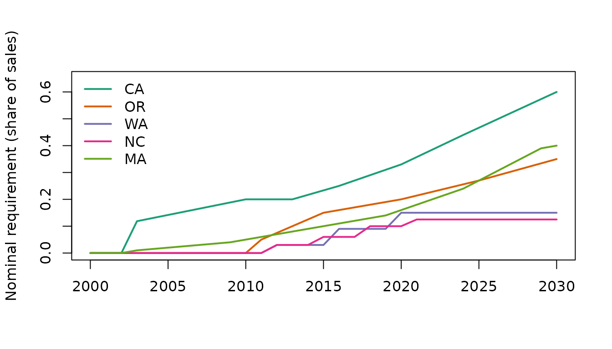

# Measuring RPS stringency

``` r

library(rpspanel)
```

Many studies code a Renewable Portfolio Standard (RPS) as a yes/no
dummy. Real policies differ in targets, timelines, covered utilities,
eligible resources, carve-outs and out-of-state flexibility.
[`rps_stringency()`](https://adebayomoses.github.io/rpspanel/reference/rps_stringency.md)
turns coded rules into comparable annual measures.

## The rule coding

``` r

rules <- rps_rules()
rules
#> <rps_rules>: 51 coded states (33 with an RPS), 273 legal targets
#>  state enacted_year first_compliance_year target_type final_target
#>     AZ         2006                  2006       share         0.15
#>     CA         2002                  2003       share          0.6
#>     CO         2004                  2007       share          0.3
#>     CT         1998                  2001       share         0.29
#>     DC         2005                  2007       share            1
#>     DE         2005                  2007       share          0.4
#>     HI         2004                  2005       share            1
#>     IA         1983                  1983 capacity_mw          105
#>     IL         2007                  2008       share          0.5
#>     KS         2009                  2011       share       0.0726
#>     MA         1997                  2003       share          0.4
#>     MD         2004                  2006       share          0.5
#>     ME         1997                  2000       share          0.6
#>     MI         2008                  2012       share          0.6
#>     MN         2007                  2010       share         0.55
#>     MO         2008                  2011       share         0.15
#>     MT         2005                  2008       share         0.15
#>     NC         2007                  2012       share        0.125
#>     NH         2007                  2008       share        0.157
#>     NJ         1999                  2002       share          0.5
#>     NM         2004                  2006       share          0.8
#>     NV         1997                  2003       share          0.5
#>     NY         2004                  2006       share          0.7
#>     OH         2008                  2009       share        0.085
#>     OR         2007                  2011       share          0.5
#>     PA         2004                  2007       share         0.08
#>     RI         2004                  2007       share         0.98
#>     TX         1999                  2002 capacity_mw         5880
#>     VA         2020                  2021       share            1
#>     VT         2015                  2017       share            1
#>     WA         2006                  2012       share         0.15
#>     WI         1999                  2006       share          0.1
#>     WV         2009                  2015       share         0.25
#>  final_target_year coverage_share
#>               2025          0.589
#>               2030          0.985
#>               2020          0.990
#>               2030          1.000
#>               2032          1.000
#>               2035          0.918
#>               2045          1.000
#>               1983          0.862
#>               2040          0.929
#>               2014          0.825
#>               2030          0.887
#>               2030          0.980
#>               2040          0.956
#>               2035          1.000
#>               2035          0.999
#>               2021          0.726
#>               2015          0.742
#>               2021          0.998
#>               2025          1.000
#>               2030          0.990
#>               2040          0.902
#>               2030          0.929
#>               2030          0.983
#>               2026          0.734
#>               2040          0.808
#>               2021          0.976
#>               2033          0.991
#>               2015          0.757
#>               2045          0.722
#>               2035          1.000
#>               2020          0.874
#>               2015          1.000
#>               2025          0.994
head(rules$targets)
#>   state year target
#> 1    AZ 2006 0.0125
#> 2    AZ 2009 0.0200
#> 3    AZ 2010 0.0250
#> 4    AZ 2015 0.0500
#> 5    AZ 2025 0.1500
#> 6    CA 2003 0.1185
```

Each RPS state has one row in `rules$rules` (enactment and first
compliance year, target type, coverage share, design features, sources
and notes) and one row per legal target in `rules$targets`. States
missing from the coding are *not yet coded*, and get `NA` rather than
zero.

> **Status.** The bundled coding covers all 50 states and DC. Rows
> marked `verified = TRUE` have been checked against the statute, the
> DSIRE program page and the LBNL RPS & CES data, with sources in the
> `source` and `notes` columns. Single-number simplifications (one
> coverage share, one schedule for states with utility-specific targets)
> are described in `notes`. Please report corrections. You can supply
> your own coding with
> `rps_rules(rules_path = ..., targets_path = ...)`.

## Methods

| method | column(s) | definition |
|----|----|----|
| `adoption` | `rps_adoption` | 1 if an RPS is in force |
| `nominal` | `rps_nominal` | required share of sales, interpolated between legal targets |
| `coverage_adjusted` | `rps_coverage_adj` | nominal x share of sales covered |
| `incremental` | `rps_incremental`, `rps_baseline_share` | coverage-adjusted requirement minus the existing renewable share at enactment (Yin and Powers 2010) |
| `flexibility` | `rps_oos_rec`, `rps_carveout`, `rps_acp` | design indicators while an RPS is in force |

``` r

s <- rps_stringency(2000:2030, states = c("CA", "OR", "WA", "NC", "MA"))
head(s[s$state == "OR", ], 15)
#>     state year rps_adoption rps_nominal rps_coverage_adj rps_incremental
#> 94     OR 2000            0       0.000           0.0000               0
#> 95     OR 2001            0       0.000           0.0000               0
#> 96     OR 2002            0       0.000           0.0000               0
#> 97     OR 2003            0       0.000           0.0000               0
#> 98     OR 2004            0       0.000           0.0000               0
#> 99     OR 2005            0       0.000           0.0000               0
#> 100    OR 2006            0       0.000           0.0000               0
#> 101    OR 2007            1       0.000           0.0000               0
#> 102    OR 2008            1       0.000           0.0000               0
#> 103    OR 2009            1       0.000           0.0000               0
#> 104    OR 2010            1       0.000           0.0000               0
#> 105    OR 2011            1       0.050           0.0404              NA
#> 106    OR 2012            1       0.075           0.0606              NA
#> 107    OR 2013            1       0.100           0.0808              NA
#> 108    OR 2014            1       0.125           0.1010              NA
#>     rps_baseline_share rps_oos_rec rps_carveout rps_acp
#> 94                  NA           0            0       0
#> 95                  NA           0            0       0
#> 96                  NA           0            0       0
#> 97                  NA           0            0       0
#> 98                  NA           0            0       0
#> 99                  NA           0            0       0
#> 100                 NA           0            0       0
#> 101                 NA           1            1       1
#> 102                 NA           1            1       1
#> 103                 NA           1            1       1
#> 104                 NA           1            1       1
#> 105                 NA           1            1       1
#> 106                 NA           1            1       1
#> 107                 NA           1            1       1
#> 108                 NA           1            1       1
```

### Linear or step interpolation

Legal schedules often step (for example Washington: 3% from 2012, 9%
from 2016, 15% from 2020). `interpolation = "step"` follows the schedule
exactly; `"linear"` (the default) spreads the ramp evenly between target
years.

``` r

lin  <- rps_stringency(2010:2022, "WA", method = "nominal")
step <- rps_stringency(2010:2022, "WA", method = "nominal",
                       interpolation = "step")
plot(lin$year, lin$rps_nominal, type = "l", ylab = "Required share", xlab = "",
     main = "Washington RPS")
lines(step$year, step$rps_nominal, type = "s", lty = 2)
legend("topleft", c("linear", "step"), lty = 1:2, bty = "n")
```


### Nominal requirements across states

``` r

cols <- c(CA = "#1b9e77", OR = "#d95f02", WA = "#7570b3", NC = "#e7298a",
          MA = "#66a61e")
plot(NA, xlim = c(2000, 2030), ylim = c(0, 0.65), xlab = "",
     ylab = "Nominal requirement (share of sales)")
for (st in names(cols)) {
  d <- s[s$state == st, ]
  lines(d$year, d$rps_nominal, col = cols[st], lwd = 2)
}
legend("topleft", names(cols), col = cols, lwd = 2, bty = "n")
```



### Incremental requirement

The incremental measure subtracts what the state already produced when
it enacted the standard, separating new pressure from existing
renewables.
[`build_panel()`](https://adebayomoses.github.io/rpspanel/reference/build_panel.md)
fills the baseline from EIA generation data: the renewable share in the
enactment year (or the first later year with data), measured the same
way as the target. For New York, whose targets count existing hydro, the
baseline includes hydro (about 19% in 2004, close to the 19.3% written
into its RPS order); elsewhere it is the non-hydro share. A
generation-based baseline is a weak guide for states that import most of
their electricity, such as Vermont. You can always pass your own
baseline:

``` r

base <- data.frame(state = c("CA", "OR"), baseline_share = c(0.11, 0.03))
inc <- rps_stringency(c(2010, 2020, 2030), c("CA", "OR"),
                      method = c("coverage_adjusted", "incremental"),
                      baseline = base)
inc
#>   state year rps_coverage_adj rps_incremental rps_baseline_share
#> 1    CA 2010          0.19700         0.08700               0.11
#> 2    CA 2020          0.32505         0.21505               0.11
#> 3    CA 2030          0.59100         0.48100               0.11
#> 4    OR 2010          0.00000         0.00000               0.03
#> 5    OR 2020          0.16160         0.13160               0.03
#> 6    OR 2030          0.28280         0.25280               0.03
```

`OR` has `NA` coverage-adjusted and incremental values because its
coverage share is not yet coded.

### Capacity-based standards (Texas and Iowa)

Texas and Iowa set their standards in megawatts rather than as a share
of sales.
[`rps_stringency()`](https://adebayomoses.github.io/rpspanel/reference/rps_stringency.md)
converts them, like Berkeley Lab does, into the share of covered sales
the capacity would supply:
`MW x capacity factor x 8,760 hours / covered sales`. The capacity
factor defaults to 0.33 (typical of wind) and can be changed.
[`build_panel()`](https://adebayomoses.github.io/rpspanel/reference/build_panel.md)
supplies retail sales automatically; with
[`rps_stringency()`](https://adebayomoses.github.io/rpspanel/reference/rps_stringency.md)
you pass them:

``` r

tx_sales <- data.frame(state = "TX", year = c(2010, 2015),
                       sales_gwh = c(358000, 380000))
rps_stringency(c(2010, 2015), "TX", method = "nominal", sales = tx_sales)
#>   state year rps_nominal
#> 1    TX 2010  0.04019296
#> 2    TX 2015  0.05909026
rps_stringency(c(2010, 2015), "TX", method = "nominal", sales = tx_sales,
               capacity_factor = 0.4)
#>   state year rps_nominal
#> 1    TX 2010  0.04871874
#> 2    TX 2015  0.07162456
```

## A template for Yin and Powers (2010)-style regressions

Yin and Powers (2010) regress the non-hydro renewable share of
generation on the incremental requirement with state and year fixed
effects. The template below shows the workflow; it is not a replication,
because their sample, coding and controls differ from the bundled
starter coding.

``` r

library(fixest)
p <- build_panel(years = 2001:2022,
                 vars = c("re_share_nonhydro", "rps_incremental",
                          "rps_adoption", "gdp_real_pc",
                          "elec_price_real"))
feols(re_share_nonhydro ~ rps_incremental + log(gdp_real_pc) + elec_price_real |
        state + year,
      data = as_pdata(p, "fixest"), cluster = ~state)
```

## Reference

Yin, H., & Powers, N. (2010). Do state renewable portfolio standards
promote in-state renewable generation? *Energy Policy*, 38(2),
1140-1149.
